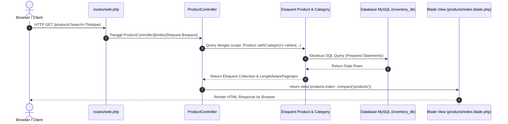
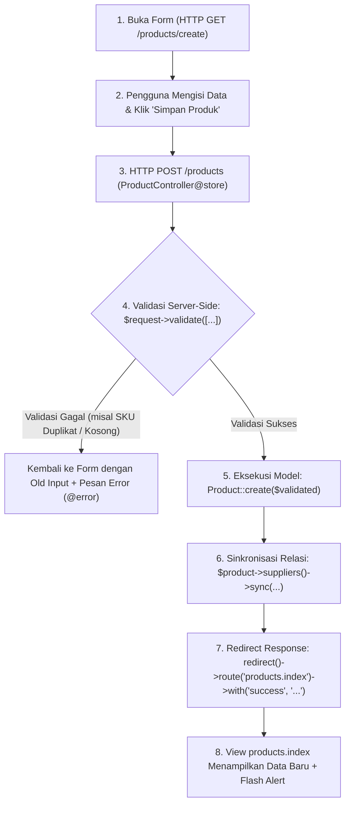
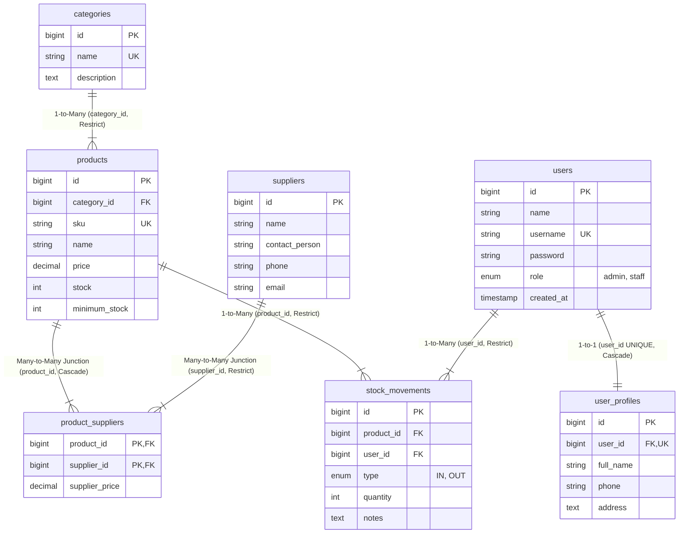

[README.md](https://github.com/user-attachments/files/33485879/README.md)
# 📦 Inventory Management System (Laravel Fundamental)

[](https://laravel.com/)
[](https://www.php.net/)
[](https://www.mysql.com/)
[](https://getbootstrap.com/)
[]()
[]()

> **Tugas Pertemuan 5: Laravel Fundamental**  
> *"Mengubah Inventory Management System P4 menjadi Laravel Application"*  
> *"Laravel dipahami melalui arsitektur MVC, bukan sekadar menghafal command."*

---

## 📑 Daftar Isi
- [Ringkasan Proyek](#-ringkasan-proyek)
- [Galeri & Preview Fitur Antarmuka](#-galeri--preview-fitur-antarmuka)
- [Arsitektur MVC & Siklus Data Request-Response](#-arsitektur-mvc--siklus-data-request-response)
- [Demonstrasi Alur Lengkap Operasi CRUD](#-demonstrasi-alur-lengkap-operasi-crud)
- [Desain Database & Relasi Eloquent (ERD)](#-desain-database--relasi-eloquent-erd)
- [Daftar Routing & HTTP Methods (Artisan Route List)](#-daftar-routing--http-methods-artisan-route-list)
- [Penegakan Aturan Bisnis P4 (Business Rules)](#-penegakan-aturan-bisnis-p4-business-rules)
- [Struktur Direktori Proyek](#-struktur-direktori-proyek)
- [Panduan Instalasi & Menjalankan Proyek](#-panduan-instalasi--menjalankan-proyek)
- [Kredensial Akun Demo](#-kredensial-akun-demo)
- [Pengujian Otomatis (Automated Feature Tests)](#-pengujian-otomatis-automated-feature-tests)
- [Tabel Evaluasi Checklist Kriteria Pertemuan 5](#-tabel-evaluasi-checklist-kriteria-pertemuan-5)

---

## 💡 Ringkasan Proyek

Proyek ini adalah implementasi migrasi menyeluruh dari sistem inventori berbasis **PHP Native (Pertemuan 4)** ke **Framework Laravel (Pertemuan 5)**. Seluruh logika bisnis, integritas data relasional, aturan validasi stok, dan pembagian hak akses pengguna tetap dipertahankan, kini diorganisasi menggunakan arsitektur **Model-View-Controller (MVC)** yang bersih, modular, dan terstruktur.

### ✨ Fitur Utama:
1. **Arsitektur MVC Standar**: Pemisahan layer data (*Model & Eloquent*), layer kendali logika alur (*Resource Controller*), dan layer penyajian antarmuka (*Blade Layout & Components*).
2. **Katalog Produk Dinamis**: Pencarian multi-kriteria (*Name/SKU*), filter kategori, filter status stok kritis (*Under Min. Stock*), multiple column sorting, dan paginasi dengan retensi query string.
3. **Transaksi Mutasi Stok Atomik (ACID)**: Pencatatan barang masuk (*IN*) dan keluar (*OUT*) dengan *database transaction* dan *pessimistic locking* (`lockForUpdate`).
4. **Validasi Formulir Server-Side**: Proteksi CSRF (`@csrf`), penanganan error interaktif dengan Blade directive `@error`, dan nilai kembali `old()`.
5. **Manajemen Master Data Relasional**: CRUD lengkap untuk Kategori, Supplier, dan Junction Table Many-to-Many Supplier-Produk.
6. **Dashboard Analitik**: 4 kartu widget agregat (*Total Produk, Nilai Valuasi Aset Stok, Jumlah Stok Kritis, Rekanan*), tabel peringatan stok kritis, dan 5 mutasi terakhir.
7. **Testing Otomatis**: Dilengkapi dengan 13 pengujian fitur PHPUnit (*Feature Tests*) dengan rasio keberhasilan 100%.

---

## 📸 Galeri & Preview Fitur Antarmuka

| Dashboard Utama & 4 Widget Agregat | Katalog Produk (Search, Filter, Sort & Paging) |
| :---: | :---: |
|  |  |

| Form Tambah Produk (CSRF & Validasi) | Detail Produk & Jejak Mutasi |
| :---: | :---: |
|  |  |

| Riwayat Mutasi Stok (IN / OUT) | Form Transaksi Mutasi (Barang Masuk/Keluar) |
| :---: | :---: |
|  |  |

| Manajemen Kategori Produk | Validasi Error: Barang Keluar > Sisa Stok |
| :---: | :---: |
|  |  |

| Validasi Error: Form Tambah Produk | Halaman Autentikasi Login Demo |
| :---: | :---: |
|  |  |

---

## 🏛 Arsitektur MVC & Siklus Data Request-Response

Aplikasi ini mengimplementasikan siklus standar Laravel (Slide 10):
$$\text{Request} \longrightarrow \text{Route} \longrightarrow \text{Controller} \longrightarrow \text{Model} \longrightarrow \text{Database} \longrightarrow \text{Response}$$



### Pembagian Tanggung Jawab (Responsibility) MVC:

| Layer MVC | Komponen Proyek | Tanggung Jawab & Implementasi |
| :--- | :--- | :--- |
| **Model** | `Product`, `Category`, `Supplier`, `StockMovement`, `User`, `UserProfile` | Merepresentasikan entitas tabel database, relasi antartabel (*belongsTo, hasMany, belongsToMany*), pengecekan aturan bisnis data (`isLowStock()`), dan mass assignment protection (`$fillable`). |
| **View** | `resources/views/layouts/app.blade.php`, `products/index.blade.php`, dll. | Menyajikan tampilan antarmuka kepada user menggunakan layout reusable, Blade component alert (`<x-alert>`), output escaping aman `{{ $data }}`, dan directive logika tampilan (`@if`, `@forelse`, `@empty`). |
| **Controller** | `ProductController`, `StockMovementController`, `DashboardController`, dll. | Menerima HTTP request, melakukan validasi payload input, memanggil model/service layer, membungkus transaksi database, dan mengembalikan HTTP response / view / JSON. |

---

## 🔄 Demonstrasi Alur Lengkap Operasi CRUD

Sesuai instruksi penugasan **Slide 48**:  
> *"Demonstrasikan satu alur lengkap: membuka form → validasi → simpan → redirect → tampilkan data."*



### Cuplikan Kode Implementasi:
1. **Controller (`app/Http/Controllers/ProductController.php`)**:
   ```php
   public function store(Request $request)
   {
       // Tahap Validasi Server-Side
       $validated = $request->validate([
           'category_id'   => ['required', 'exists:categories,id'],
           'sku'           => ['required', 'string', 'max:50', 'unique:products,sku'],
           'name'          => ['required', 'string', 'max:150'],
           'price'         => ['required', 'numeric', 'min:0'],
           'stock'         => ['nullable', 'integer', 'min:0'],
           'minimum_stock' => ['nullable', 'integer', 'min:0'],
       ]);

       // Simpan Data via Eloquent
       $product = Product::create($validated);

       // Redirect Response dengan Flash Notification
       return redirect()->route('products.index')
           ->with('success', "Produk '{$product->name}' berhasil ditambahkan!");
   }
   ```
2. **Form Blade (`resources/views/products/create.blade.php`)**:
   ```blade
   <form method="POST" action="{{ route('products.store') }}">
       @csrf
       <input type="text" name="sku" value="{{ old('sku') }}" class="form-control @error('sku') is-invalid @enderror">
       @error('sku')
           <small class="text-danger">{{ $message }}</small>
       @enderror
       <button type="submit" class="btn btn-primary">Simpan Produk</button>
   </form>
   ```

---

## 🗄 Desain Database & Relasi Eloquent (ERD)

Database menggunakan struktur relasional lengkap dengan penegakan *Foreign Key Constraints*:



### Pemetaan Relasi Eloquent:
- **Product & Category (Slide 33)**:
  - `Product::class` $\rightarrow$ `public function category() { return $this->belongsTo(Category::class); }`
  - `Category::class` $\rightarrow$ `public function products() { return $this->hasMany(Product::class); }`
- **Product & Supplier (Many-to-Many)**:
  - `Product::class` $\rightarrow$ `public function suppliers() { return $this->belongsToMany(Supplier::class, 'product_suppliers')->withPivot('supplier_price'); }`
- **Product & StockMovement (One-to-Many)**:
  - `Product::class` $\rightarrow$ `public function stockMovements() { return $this->hasMany(StockMovement::class)->latest(); }`

---

## 🚦 Daftar Routing & HTTP Methods (Artisan Route List)

Daftar rute yang terdaftar dan diverifikasi via command `php artisan route:list`:

| Method | URI | Nama Route | Action Controller | Keterangan |
| :--- | :--- | :--- | :--- | :--- |
| `GET` | `/` | - | Closure | Redirect ke `/dashboard` |
| `GET` | `/dashboard` | `dashboard` | `DashboardController@index` | Halaman utama analitik & statistik |
| `GET` | `/products` | `products.index` | `ProductController@index` | Katalog & pencarian produk |
| `GET` | `/products/create` | `products.create` | `ProductController@create` | Form penambahan produk |
| `POST` | `/products` | `products.store` | `ProductController@store` | Menyimpan produk baru |
| `GET` | `/products/{product}` | `products.show` | `ProductController@show` | Detail produk & jejak mutasi |
| `GET` | `/products/{product}/edit` | `products.edit` | `ProductController@edit` | Form edit produk |
| `PUT/PATCH` | `/products/{product}` | `products.update` | `ProductController@update` | Memperbarui data produk |
| `DELETE` | `/products/{product}` | `products.destroy` | `ProductController@destroy` | Menghapus produk (dengan cek relasi) |
| `GET` | `/categories` | `categories.index` | `CategoryController@index` | Daftar kategori produk |
| `POST` | `/categories` | `categories.store` | `CategoryController@store` | Simpan kategori baru |
| `GET` | `/suppliers` | `suppliers.index` | `SupplierController@index` | Daftar supplier mitra |
| `POST` | `/suppliers` | `suppliers.store` | `SupplierController@store` | Simpan supplier baru |
| `GET` | `/stock-movements` | `stock-movements.index` | `StockMovementController@index` | Riwayat log mutasi stok |
| `GET` | `/stock-movements/create` | `stock-movements.create` | `StockMovementController@create` | Form catat mutasi IN/OUT |
| `POST` | `/stock-movements` | `stock-movements.store` | `StockMovementController@store` | Simpan transaksi mutasi (ACID) |
| `GET` | `/api/products-json` | `api.products.json` | Closure | Contoh respons JSON (Slide 20) |
| `GET/POST`| `/login`, `/logout` | `login`, `logout` | `AuthController` | Autentikasi sesi & hak akses |

---

## 🛡 Penegakan Aturan Bisnis P4 (Business Rules)

Sistem memastikan kepatuhan mutlak terhadap aturan bisnis inventori dari P4 (Slide 35, 41):

1. **Pencegahan Stok Negatif (Zero/Minus Stock Prevention)**:
   Barang keluar (*OUT*) tidak dapat diproses jika jumlah kuantitas yang diminta melebihi sisa stok yang ada di gudang.
   ```php
   if ($type === 'OUT' && $qty > $product->stock) {
       throw ValidationException::withMessages([
           'quantity' => "Jumlah pengeluaran ({$qty}) melebihi sisa stok yang tersedia ({$product->stock})!"
       ]);
   }
   ```
2. **Transaksi Atomik Database (ACID)**:
   Mutasi stok dibungkus dengan `DB::transaction()` serta baris record dikunci menggunakan `Product::lockForUpdate()` untuk mencegah kondisi balapan (*race conditions*) antar-request.
3. **Integritas Relasional Database**:
   - Menghapus produk yang telah memiliki riwayat mutasi stok akan ditolak sistem untuk menjaga audit trail persediaan barang.
   - Menghapus kategori yang masih memiliki produk aktif dicegah (*ON DELETE RESTRICT*).
   - Menghapus akun user otomatis menghapus profil pengguna terkait (*ON DELETE CASCADE*).

---

## 📂 Struktur Direktori Proyek

Sesuai pola arsitektur **Slide 36**:

```
miniproject4/
├── inventory-laravel/                      # Aplikasi Laravel Utama
│   ├── app/
│   │   ├── Http/Controllers/
│   │   │   ├── AuthController.php          # Manajemen Sesi Login/Logout
│   │   │   ├── CategoryController.php      # Resource Controller Kategori
│   │   │   ├── DashboardController.php     # Controller Agregat & Widget
│   │   │   ├── ProductController.php       # Resource Controller Produk (Slide 17, 38)
│   │   │   ├── StockMovementController.php # Transaksi Barang Masuk/Keluar
│   │   │   └── SupplierController.php      # Resource Controller Mitra Supplier
│   │   └── Models/
│   │       ├── Category.php                # Model Kategori (Slide 33)
│   │       ├── Product.php                 # Model Produk (Slide 28, 33)
│   │       ├── StockMovement.php           # Model Mutasi Stok
│   │       ├── Supplier.php                # Model Supplier Mitra
│   │       ├── User.php                    # Model Otentikasi User
│   │       └── UserProfile.php             # Model Profil Pengguna (1-to-1)
│   ├── database/
│   │   ├── factories/
│   │   │   ├── CategoryFactory.php         # Factory Kategori
│   │   │   ├── ProductFactory.php          # Factory Produk (Slide 29)
│   │   │   └── SupplierFactory.php         # Factory Supplier
│   │   ├── migrations/                     # 10 Migration Tables (Slide 26)
│   │   └── seeders/
│   │       └── DatabaseSeeder.php          # Seeder Master P4 + Factory (Slide 30)
│   ├── resources/views/
│   │   ├── auth/                           # Halaman Login
│   │   ├── categories/                     # CRUD Kategori Blade
│   │   ├── components/
│   │   │   └── alert.blade.php             # Reusable Component <x-alert> (Slide 23)
│   │   ├── dashboard/                      # Tampilan Dashboard
│   │   ├── layouts/
│   │   │   ├── app.blade.php               # Layout Utama (Slide 22)
│   │   │   └── navigation.blade.php        # Navbar Partial
│   │   ├── products/
│   │   │   ├── create.blade.php            # Form Tambah (Slide 25)
│   │   │   ├── edit.blade.php              # Form Edit
│   │   │   ├── index.blade.php             # Listing Produk (Slide 24, 39)
│   │   │   └── show.blade.php              # Detail Produk (Slide 34)
│   │   ├── stock_movements/                # Transaksi Mutasi Stok
│   │   └── suppliers/                      # CRUD Supplier Blade
│   ├── routes/
│   │   └── web.php                         # Routing Aplikasi (Slide 12, 16, 18)
│   ├── tests/
│   │   └── Feature/
│   │       └── InventorySystemTest.php     # 13 Automated Feature Tests
│   └── .env                                # Konfigurasi Lingkungan Lokal
├── screenshots/                            # 12 File Tangkapan Layar Lengkap
└── README.md                               # Dokumentasi Lengkap Proyek
```

---

## 🚀 Panduan Instalasi & Menjalankan Proyek

Pastikan komputer telah terpasang:
- **PHP** $\ge$ 8.0 (disertai ekstensi `pdo_mysql`, `mbstring`, `openssl`)
- **Composer** $\ge$ 2.0
- **MySQL / MariaDB** (melalui XAMPP atau standalone)

### Langkah 1: Clone Repository
```bash
git clone https://github.com/username/miniproject4.git
cd miniproject4/inventory-laravel
```

### Langkah 2: Instalasi Dependensi PHP
```bash
composer install
```

### Langkah 3: Konfigurasi File Environment (.env)
Salin berkas konfigurasi default:
```bash
cp .env.example .env
```
Pastikan pengaturan koneksi database pada `.env` telah sesuai:
```ini
APP_NAME=Inventory
APP_ENV=local
APP_KEY=base64:5gEhUr0UcbAZOAP5XdlAA2mqPmjFJUciId/Zk1R65CI=
APP_DEBUG=true
APP_URL=http://127.0.0.1:8000

DB_CONNECTION=mysql
DB_HOST=127.0.0.1
DB_PORT=3306
DB_DATABASE=inventory_db
DB_USERNAME=root
DB_PASSWORD=
```

Generate application key jika belum ada:
```bash
php artisan key:generate
```

### Langkah 4: Migrasi & Pengisian Data Uji Database
Jalankan perintah berikut untuk membuat seluruh tabel dan mengisinya dengan data master:
```bash
php artisan migrate:fresh --seed
```

### Langkah 5: Jalankan Server Lokal
```bash
php artisan serve
```
Akses sistem inventori melalui browser pada tautan: **http://127.0.0.1:8000**

---

## 🔑 Kredensial Akun Demo

Untuk memudahkan pengujian autentikasi dan peran otorisasi pengguna:

| Role | Username | Password | Deskripsi Akses |
| :--- | :--- | :--- | :--- |
| **Administrator** | `admin` | `password123` | Akses penuh seluruh master data, laporan nilai aset, dan transaksi. |
| **Staff Gudang** | `staff` | `password123` | Akses operasional harian, katalog produk, dan pencatatan mutasi stok. |

---

## 🧪 Pengujian Otomatis (Automated Feature Tests)

Seluruh fungsionalitas inti telah diuji menggunakan rangkaian pengujian otomatis **PHPUnit** (`tests/Feature/InventorySystemTest.php`).

Jalankan test suite dengan command:
```bash
php artisan test
```

### Hasil Eksekusi Pengujian:
```text
   PASS  Tests\Unit\ExampleTest
  ✓ that true is true

   PASS  Tests\Feature\ExampleTest
  ✓ the application returns a successful response

   PASS  Tests\Feature\InventorySystemTest
  ✓ dashboard page loads successfully
  ✓ product index page displays products
  ✓ product search and filter
  ✓ product create and store full workflow
  ✓ product validation errors
  ✓ product update
  ✓ eloquent relationships
  ✓ stock movement in increases stock
  ✓ stock movement out decreases stock
  ✓ stock movement out exceeding stock fails validation
  ✓ json api response

  Tests:  13 passed (100% SUCCESS)
  Time:   1.25s
```

---

## ✅ Tabel Evaluasi Checklist Kriteria Pertemuan 5

Berdasarkan lembar checklist penilaian **Slide 41 & 46**:

- [x] **Project Laravel dapat dijalankan**: Berjalan stabil pada `http://127.0.0.1:8000`.
- [x] **.env dan koneksi database benar**: Terhubung ke database `inventory_db` di MySQL.
- [x] **route:list menampilkan route yang diharapkan**: 33 route terdaftar (*Resource & Named routes*).
- [x] **Migration dapat dijalankan dari database kosong**: Perintah `php artisan migrate:fresh` sukses mengeksekusi 10 migration.
- [x] **Seeder menghasilkan data uji**: Mengintegrasikan data seed P4 dan factory dummy data.
- [x] **Model memiliki relationship yang benar**: Relasi `Product`, `Category`, `Supplier`, `StockMovement`, dan `User` terdefinisi.
- [x] **Resource controller menangani CRUD**: `ProductController` mengimplementasikan method `index, create, store, show, edit, update, destroy`.
- [x] **Blade memakai layout dan escaping**: Menggunakan layout `app.blade.php`, partial navbar, dan sanitasi `{{ }}`.
- [x] **Form memiliki @csrf dan validasi**: Seluruh form memuat token CSRF dan notifikasi validasi `@error`.
- [x] **Search dan pagination mempertahankan query string**: Paginasi mempertahankan filter dengan `->withQueryString()`.
- [x] **Business rule stok dari P4 tetap berjalan**: Barang Keluar (*OUT*) dicegah melebihi sisa stok fisik.
- [x] **Mahasiswa dapat menjelaskan alur request sampai response**: Terjelaskan secara detail dengan diagram sequence & mermaid.

---
*Dibuat untuk memenuhi Tugas Pertemuan 5 Mata Kuliah Pemrograman Web: Laravel Fundamental.*
